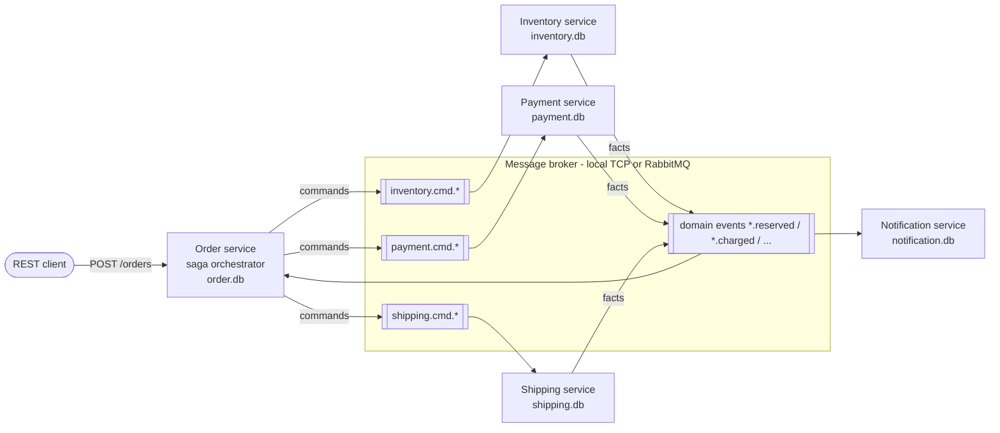
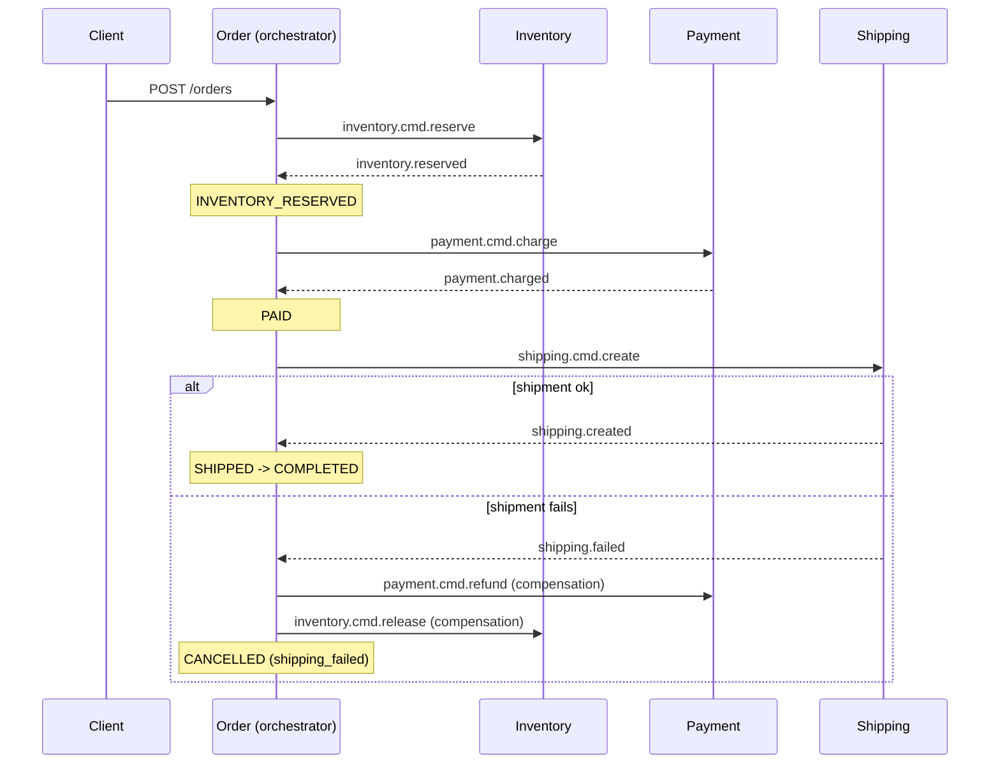

# Event-Driven Order Processing System

Five Node.js/TypeScript microservices coordinating an order saga over a message
broker - with **compensating transactions**, **consumer idempotency under
at-least-once delivery**, **out-of-order tolerance**, and **distributed tracing**
(one trace per order across all services).

The whole system runs and demos with **zero external services**: a built-in
local broker (in-process or over TCP for real multi-process runs), one SQLite
file per service, and a JSON-file span exporter. A code-complete RabbitMQ
adapter and an OTLP/Jaeger exporter are selected purely via environment
variables, with an optional `docker-compose.yml` for that path.

```
npm install
npm test        # broker semantics, saga paths, idempotency, out-of-order
npm run demo    # broker + 5 services as real processes, 4 scenarios, report
```

## Architecture



Every service owns its SQLite file; **no service ever touches another
service's database**. The only integration points are events on the broker and
the Order service's public REST API.

### Saga flow (orchestration)



Order status machine: `PENDING -> INVENTORY_RESERVED -> PAID -> SHIPPED ->
COMPLETED`, with `CANCELLED(reason)` reachable from every pre-terminal state.

| Failure | Compensations executed |
|---|---|
| `inventory.rejected` (insufficient stock) | none needed - nothing was reserved |
| `payment.failed` | release reserved inventory |
| `shipping.failed` | **refund payment AND release inventory** |

## Design decisions

### Why event-driven + saga

An order spans four business capabilities with four separate databases. A
distributed ACID transaction (2PC) across them would couple availability of
all services and doesn't exist for heterogeneous stores anyway. The saga
pattern replaces one atomic transaction with a sequence of *local* ACID
transactions, each publishing a fact; failures are unwound by explicit
**compensating transactions** (refund, release) rather than rollback.

### Why orchestration (and not choreography)

Both styles are valid; this project uses **orchestration in the Order
service**:

- The order state machine lives in exactly one place and is unit-testable as
  such. With choreography the "process" only exists implicitly, smeared
  across every service's subscriptions.
- Compensation logic is the hard part of a saga. The orchestrator decides
  *refund AND release* on `shipping.failed`; in choreography, Payment and
  Inventory would each need to know they must react to shipping's failure -
  a hidden coupling that grows quadratically as steps are added.
- Participants stay generic: Inventory/Payment/Shipping only answer commands
  (`*.cmd.*`) with facts (`*.reserved`, `*.failed`, ...) and know nothing
  about order workflows.

Trade-off acknowledged: the orchestrator is a logical single point of
coordination (not of failure - commands/replies are durable on the broker and
the orchestrator is stateless between events, so it can restart and resume).

### Delivery guarantees: at-least-once + dedup = effectively-once

Exactly-once *delivery* is a myth over lossy transports; the broker (local or
RabbitMQ) guarantees **at-least-once**: unacked messages are redelivered,
redelivered messages may race their first copy, and the demo broker can
inject duplicates and reordering on purpose. Correctness is restored at the
consumer with idempotency - "effectively-once *processing*".

### Idempotency: the transactional inbox (+ outbox)

Every event carries `eventId`, `orderId`, `correlationId`, `causationId`.
Each consumer keeps two extra tables in its own database:

```
processed_events(event_id PRIMARY KEY, ...)   -- the inbox
outbox(id, causation_event_id, event_json, published, ...)
```

Processing one delivery is a single SQLite transaction:

1. `INSERT OR IGNORE` the `eventId` into `processed_events`.
   If it was already there -> record a row in `duplicate_deliveries`,
   **skip the business logic entirely** (duplicate = no-op), and re-publish
   any outbox rows the first processing failed to publish.
2. Run the handler: business state change + stage outgoing events in `outbox`.
3. Commit. Only then publish the staged events and mark them published, then
   ack the delivery.

Because the inbox insert and the state change commit **atomically**, a crash
at any point leaves the system consistent: crash before commit -> redelivery
reprocesses from scratch; crash after commit but before publish/ack ->
redelivery is detected as a duplicate, the state change is skipped, and the
unpublished outbox rows are recovered and sent. Services also flush any
unpublished outbox rows on startup.

### Out-of-order tolerance

The orchestrator's transitions are guarded by the current status
(`payment.charged` only applies in `INVENTORY_RESERVED`, etc.). Late, stale,
or reordered events are recorded in the order's event history as
`ignored (stale/out-of-order...)` and cause no state change - tested by
publishing a rogue `shipping.created` after a saga already compensated.
Participant services guard similarly (a release for a non-active reservation
is a no-op), so compensations can never double-release stock or double-refund.

### Distributed tracing

Every service initializes the OpenTelemetry SDK. `POST /orders` starts the
root SERVER span; every publish wraps a PRODUCER span and **injects the W3C
`traceparent` into the message headers**; every consumer extracts it and
starts a CONSUMER span as a child. One order therefore yields exactly one
trace spanning order -> inventory -> payment -> shipping -> notification,
across process boundaries and whichever broker transport is active.

- Offline default: JSON-lines span files under `data/traces/*.spans.jsonl`
  (the demo prints per-order trace summaries from them).
- With infra: set `OTEL_EXPORTER_OTLP_ENDPOINT=http://localhost:4318` and the
  same traces appear in Jaeger.

Structured JSON logs additionally carry `correlationId`/`orderId`/`eventId`,
so one saga can be grepped across all service logs.

### Broker abstraction

`MessageBroker` (publish / pattern subscribe with consumer groups / ack /
nack / redelivery) has three implementations selected by env:

| Selection | Implementation |
|---|---|
| `RABBITMQ_URL` set | `RabbitMqBroker` - amqplib, topic exchange, durable per-(group,pattern) queues, manual ack, dead-letter exchange + DLQ |
| `BROKER_URL` set (`tcp://...`) | `TcpBrokerClient` -> tiny `BrokerTcpServer` (ndjson over TCP) so services run as separate OS processes with zero infrastructure; reconnect + resubscribe built in |
| neither | `InMemoryBroker` in-process (tests) |

The TCP server wraps the same `InMemoryBroker` core, so local unit tests, the
multi-process demo, and (modulo the adapter) RabbitMQ all share one semantic
model: per-group queues, round-robin within a group, ack timeout ->
redelivery, max-deliveries -> dead-letter queue.

Fault injection knobs (local broker): `BROKER_DUPLICATE_TOPICS` (deliver
matching messages twice per group), `BROKER_JITTER_MS` (random delivery delay
=> reordering), `BROKER_ACK_TIMEOUT_MS`, `BROKER_REDELIVERY_DELAY_MS`,
`BROKER_MAX_DELIVERIES`.

## Repository layout

```
packages/common          shared kernel: event contracts, broker interface +
                         3 implementations, transactional inbox/outbox,
                         OpenTelemetry setup, structured logging, sqlite wrapper
packages/demo            npm run demo orchestrator
services/order           REST API + saga orchestrator          (order.db)
services/inventory       stock reserve/release                 (inventory.db)
services/payment         charge/refund ledger                  (payment.db)
services/shipping        shipment creation                     (shipping.db)
services/notification    per-stage customer notifications      (notification.db)
tests/                   vitest: broker, tcp transport, saga, idempotency,
                         out-of-order
```

SQLite driver: `better-sqlite3` when its optional native install succeeded,
otherwise the built-in `node:sqlite` - override with `SQLITE_DRIVER=node|better`.

## REST API (Order service)

```
POST /orders            {"items":[{"sku":"WIDGET","qty":2}]}    -> 201 order
GET  /orders/:id        status + full event history + compensations
GET  /orders            list
GET  /health
```

Seeded inventory on first run: `WIDGET:100, GADGET:50, GIZMO:25,
FAIL_PAYMENT:1000, FAIL_SHIPPING:1000`.

## Failure injection guide

Deterministic, payload-driven - no flags to flip anywhere:

| You send | What happens |
|---|---|
| `{"sku":"WIDGET","qty":2}` | happy path -> `COMPLETED` |
| `{"sku":"GADGET","qty":9999}` | `inventory.rejected` -> `CANCELLED(insufficient_stock)` |
| `{"sku":"FAIL_PAYMENT","qty":1}` | payment declined -> inventory released -> `CANCELLED(payment_failed)` |
| `{"sku":"FAIL_SHIPPING","qty":1}` | shipment fails -> payment refunded + inventory released -> `CANCELLED(shipping_failed)` |

## The demo

`npm run demo` builds, then:

1. starts the local TCP broker with **duplicate-delivery injection enabled**
   for `payment.cmd.charge` and `inventory.reserved`, plus delivery jitter;
2. starts all five services as separate Node processes (own DB file + own
   span file each; logs in `data/logs/`);
3. places the four scenario orders through the REST API;
4. waits for every saga to settle, then gracefully stops all children
   (stdin-based shutdown - Windows-safe);
5. prints per-order status + event timeline, compensations executed,
   duplicate-delivery no-op counts per service, and per-order trace summary;
   exits non-zero if any expectation failed.

## Running it manually (multi-terminal)

```
npm run build
npm run broker                                # terminal 1
set BROKER_URL=tcp://127.0.0.1:47100          # (per terminal; use $env: in PowerShell)
npm run start:inventory                       # terminal 2
npm run start:payment                         # terminal 3
npm run start:shipping                        # terminal 4
npm run start:notification                    # terminal 5
npm run start:order                           # terminal 6 (PORT=3000)

curl -X POST http://localhost:3000/orders -H "content-type: application/json" ^
     -d "{\"items\":[{\"sku\":\"WIDGET\",\"qty\":2}]}"
```

## Optional: RabbitMQ + Jaeger via Docker

Nothing in the local workflow needs Docker. If you have it:

```
docker compose up --build
```

- Order API on `http://localhost:3000`, RabbitMQ management UI on `:15672`
  (guest/guest), Jaeger UI on `:16686`.
- The services run unchanged - only `RABBITMQ_URL` and
  `OTEL_EXPORTER_OTLP_ENDPOINT` differ. Place orders as above and watch one
  trace per order in Jaeger, and the DLQ (`os.dead-letters`) in RabbitMQ.

## Tests

```
npm test
```

- `broker.test.ts` - pattern matching; ack/redelivery/ack-timeout; nack and
  dead-lettering; max-deliveries; consumer-group round-robin; backlog;
  duplicate injection.
- `tcp-broker.test.ts` - the cross-process transport: pub/sub/ack and
  nack-redelivery over real TCP sockets.
- `saga.test.ts` - happy path and every failure/compensation path, asserted
  both on the orchestrator's history and on each participant's own database;
  plus the REST API end-to-end.
- `idempotency.test.ts` - broker-injected duplicates cause exactly one state
  change (proved on inventory stock and on saga command counts), plus a unit
  test of the inbox/outbox crash-recovery contract.
- `out-of-order.test.ts` - stale `shipping.created` / `payment.charged`
  after cancellation are ignored; unknown-order events don't poison anything.
